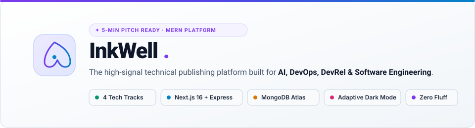
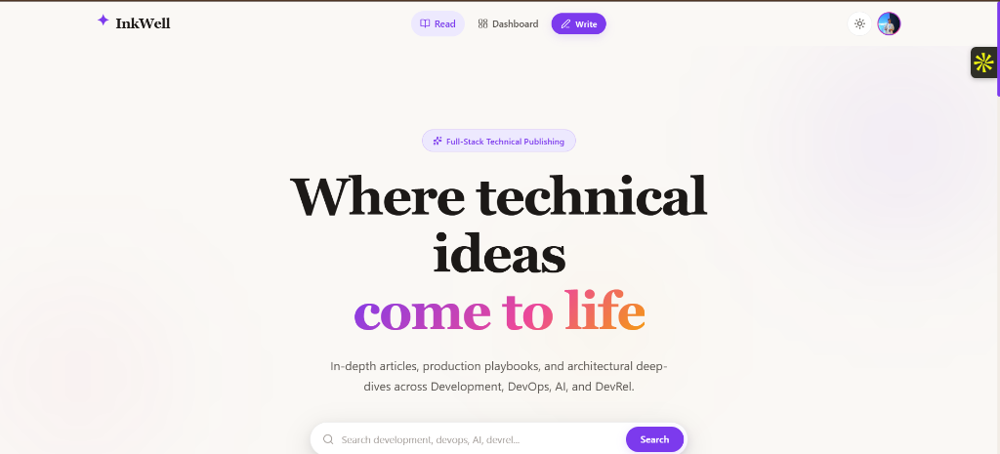
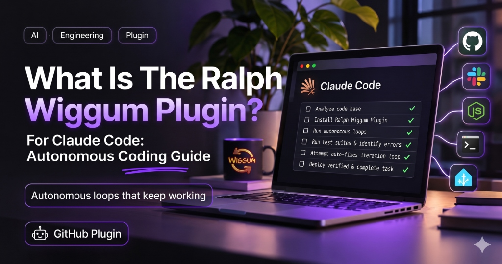
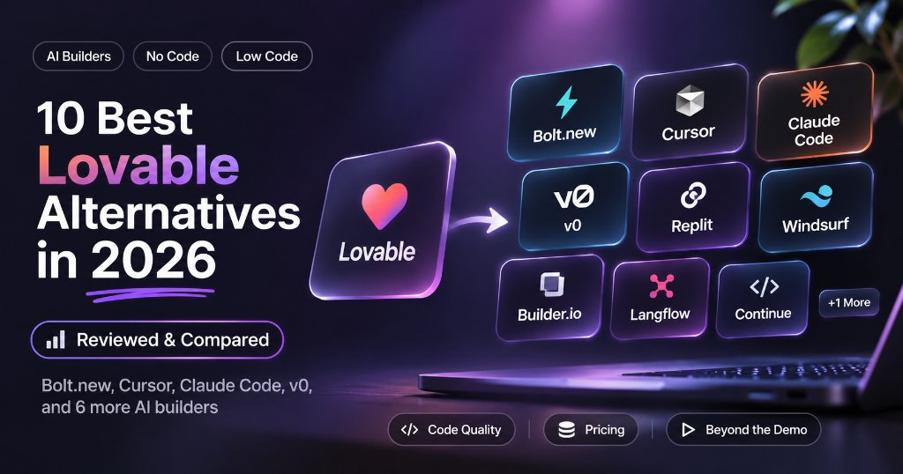
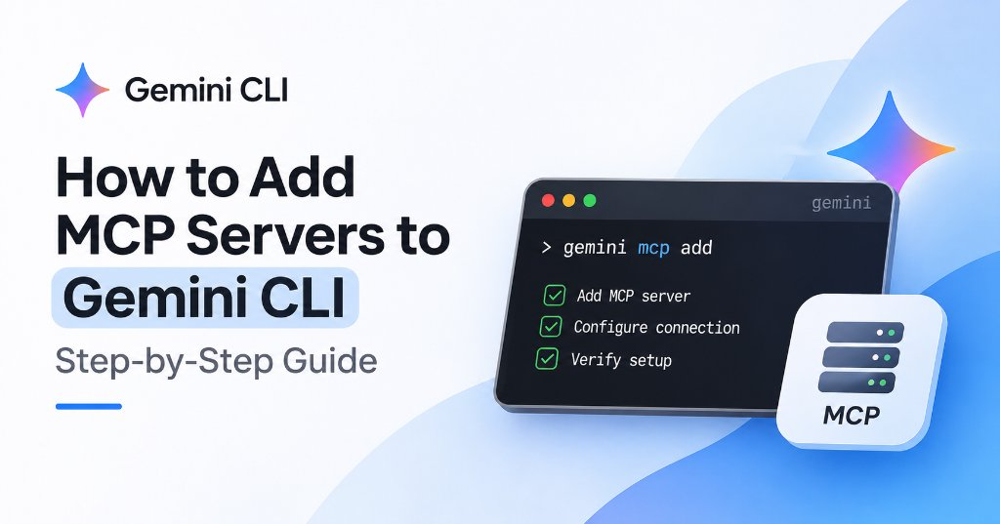

<div align="center">

<picture>
  <source media="(prefers-color-scheme: dark)" srcset="assets/dark/header-dark.svg"/>
  
</picture>

<br/>

<a href="https://github.com/adityab894/inkwell"><picture><source media="(prefers-color-scheme: dark)" srcset="https://img.shields.io/badge/GITHUB-adityab894%2Finkwell-0d1117?style=flat-square&logo=github&logoColor=ffffff"/></picture></a>
<a href="http://localhost:3000"><picture><source media="(prefers-color-scheme: dark)" srcset="https://img.shields.io/badge/LIVE%20DEMO-localhost%3A3000-0d1117?style=flat-square&logo=googlechrome&logoColor=38bdf8"/></picture></a>
<a href="#pitch-guide"><picture><source media="(prefers-color-scheme: dark)" srcset="https://img.shields.io/badge/🎙️%205--MIN%20PITCH-GUIDE-7c3aed?style=flat-square&logoColor=ffffff"/></picture></a>
<a href="#quick-start"><picture><source media="(prefers-color-scheme: dark)" srcset="https://img.shields.io/badge/🚀%20QUICK%20START-1--MIN%20SETUP-059669?style=flat-square&logoColor=ffffff"/></picture></a>
<a href="https://github.com/adityab894"><picture><source media="(prefers-color-scheme: dark)" srcset="https://img.shields.io/badge/AUTHOR-Aditya%20Bisht-0d1117?style=flat-square&logo=github&logoColor=c084fc"/></picture></a>

<br/><br/>

<!-- Tech Badges Bar -->
<p align="center">
  
  
  
  
  
  
  
  
</p>

<!-- Live Application Dashboard Banner Preview -->
<a href="http://localhost:3000">
  
</a>

</div>

<br/>

---

<picture>
  <source media="(prefers-color-scheme: dark)" srcset="assets/dark/s01.svg"/>
  
</picture>

### 💡 The Problem: The Modern Developer Publishing Dilemma

Technical writers and software engineers face a painful trade-off with existing blogging channels:

- **Medium**: Paywalls block technical readers from inspecting code snippets and architecture diagrams.
- **Substack**: Strictly an email newsletter tool — lacks syntax highlighting, code playgrounds, and technical categorization.
- **Hashnode / Dev.to**: Cluttered with third-party platform branding, algorithmic noise, and unrelated non-technical fluff.

### ⚡ The Solution: InkWell

**InkWell** is a specialized, open-source, reader-first technical publishing platform built with a high-performance **MERN stack (Next.js 16 App Router + Express.js + MongoDB Atlas)**. It eliminates algorithmic distractions and provides an uncompromising, distraction-free environment dedicated strictly to four technical domains:

```
┌────────────────────────────────────────────────────────────────────────┐
│                        ✦ INKWELL PLATFORM ✦                           │
├─────────────────┬──────────────────┬─────────────────┬─────────────────┤
│  🤖 AI          │  🛠️ DEVELOPMENT  │  ⚙️ DEVOPS       │  🤝 DEVREL      │
│  Agents, MCPs,  │  React 19, Next, │  Docker, CI/CD, │  Tech Strategy, │
│  Autonomous LLM │  Full-Stack SDKs │  Cloud & Infra  │  DX & Community │
└─────────────────┴──────────────────┴─────────────────┴─────────────────┘
```

> **Zero Fluff Policy:** No lifestyle, food, or web3 spam. 100% focused on software engineering excellence and actionable knowledge.

<br/>

---

<picture>
  <source media="(prefers-color-scheme: dark)" srcset="assets/dark/s02.svg"/>
  
</picture>

InkWell features **24 production-grade technical articles** pre-ingested from top engineering authors, organized into four specialized tracks:

| Track                 | Core Focus & Topics                                                                          | Sample Featured Publications                                                                                                                                                                                                                |
| :-------------------- | :------------------------------------------------------------------------------------------- | :------------------------------------------------------------------------------------------------------------------------------------------------------------------------------------------------------------------------------------------ |
| **🤖 AI Engineering** | Autonomous AI Agents, Context Engineering, Model Context Protocol (MCP), LLM Prompt Loops    | • _Ralph Wiggum Plugin for Claude Code: Autonomous Coding Guide_<br/>• _Claude Code Plan Mode: What's Missing and How to Fix It_<br/>• _Context Engineering: What You're Actually Doing_<br/>• _What Is OpenClaw? The Open-Source AI Agent_ |
| **🛠️ Development**    | Modern Full-Stack Web Development, State Machines, Framework Alternatives, SDK Architectures | • _10 Best Lovable Alternatives in 2026 (Reviewed & Compared)_<br/>• _7 Best Replit Alternatives: Cloud vs Local Workflows_<br/>• _Learn to Use Supabase with Next.js_<br/>• _useState(): Understanding the Hook with Real State_           |
| **⚙️ DevOps & Cloud** | Agentic Tooling, Developer Environments, MCP Server Integration, Tool Automation             | • _How to Add MCP Servers to Gemini CLI (Step-by-Step)_<br/>• _Claude Code MCP Servers: Complete Setup Guide (2026)_<br/>• _Why Package Managers Are the Backbone of DevOps_                                                                |
| **🤝 DevRel & DX**    | Technical Content Strategy, Developer Advocacy, Documentation Engineering, API Ergonomics    | • _Optexity: The DevRel & Technical Content Strategy Field Guide_<br/>• _No One Told Me How to Do This, So I'm Telling You Instead_                                                                                                         |

<br/>

### 📸 Featured Article Showcase

<div align="center">
  <table width="100%">
    <tr>
      <td width="33%" align="center">
        <br/>
        <b>🤖 Autonomous Loops</b><br/>
        <sub>Ralph Wiggum for Claude Code</sub>
      </td>
      <td width="33%" align="center">
        <br/>
        <b>🛠️ Full-Stack Builders</b><br/>
        <sub>10 Best Lovable Alternatives in 2026</sub>
      </td>
      <td width="33%" align="center">
        <br/>
        <b>⚙️ Cloud & Tooling</b><br/>
        <sub>Adding MCP Servers to Gemini CLI</sub>
      </td>
    </tr>
  </table>
</div>

<br/>

---

<picture>
  <source media="(prefers-color-scheme: dark)" srcset="assets/dark/s03.svg"/>
  
</picture>

### 1. 🌓 True High-Contrast Dark Mode (Zero Fatigue)

Unlike generic platforms that render dim gray body text on dark backgrounds, InkWell features an **adaptive CSS token system** enforcing pure white (`#ffffff` / `#f8fafc`) body typography in dark mode with a deep obsidian canvas (`#0f0e0d`).

### 2. ✍️ Natural LTR WYSIWYG Composer

- **Non-destructive Caret Syncing:** Avoids the classic React `contentEditable` caret inversion bug by isolating active DOM focus from background state re-renders.
- **Instant Media Replacement:** Click any image inside the editor to swap URLs or delete on the fly.
- **Smart Reading Time Engine:** Real-time word calculation and reading minute estimator calculated live as you write.

### 3. 🎨 Author Typography & Layout Engine

Writers have full control over the visual presentation of their essays without writing custom CSS:

- **Font Stacks:** Georgia (Classic), Merriweather (Editorial), Lora (Literary), Inter (Clean), Playfair Display (Elegant).
- **Layout Presets:** **Classic** (single column long-form), **Magazine** (feature editorial), **Minimal** (distraction-free markdown).

### 4. 📊 Reader Telemetry & Analytics

- **Live Heart Interactions:** Realistic engagement telemetry with randomized baseline likes (10–30 likes per article) and live toggle states.
- **View Counter:** Increments on single article route access.
- **Tag & Topic Taxonomy:** Multi-tag indexing and instant domain chip filtering.

## <br/>

<picture>
  <source media="(prefers-color-scheme: dark)" srcset="assets/dark/s05.svg"/>
  
</picture>

```
                       ┌───────────────────────────────┐
                       │   Next.js 16 Client (React 19)│
                       │   • App Router with Turbopack │
                       │   • Adaptive Dark/Light Mode  │
                       │   • Real-Time WYSIWYG Studio  │
                       └──────────────┬────────────────┘
                                      │ HTTP / JSON (Axios)
                                      ▼
                       ┌───────────────────────────────┐
                       │   Express.js API (Node.js)    │
                       │   • JWT Middleware Auth Shield│
                       │   • Multer Multipart Uploads  │
                       │   • Slugs & Read-Time Engine  │
                       └──────────────┬────────────────┘
                                      │ Mongoose ODM
                                      ▼
                       ┌───────────────────────────────┐
                       │   MongoDB Atlas Cloud Cluster │
                       │   • Articles (Schema & Layout)│
                       │   • Users & Author Avatars    │
                       │   • Interactive Like Telemetry│
                       └───────────────────────────────┘
```

### 🔌 REST API Endpoints Overview

| Method   | Endpoint                       |    Access    | Purpose                                                          |
| :------- | :----------------------------- | :----------: | :--------------------------------------------------------------- |
| `GET`    | `/api/articles?page=1&limit=9` |    Public    | Paginated technical articles feed with domain & search filtering |
| `GET`    | `/api/articles/:slug`          |    Public    | Fetch full article by slug & auto-increment read view counter    |
| `POST`   | `/api/articles`                | Author (JWT) | Create and publish a new technical article                       |
| `PUT`    | `/api/articles/:id`            | Author (JWT) | Edit article content, cover image, or custom typography layout   |
| `DELETE` | `/api/articles/:id`            | Author (JWT) | Remove article permanently                                       |
| `POST`   | `/api/articles/:id/like`       |  User (JWT)  | Toggle reactive heart like on an article                         |
| `POST`   | `/api/auth/register`           |    Public    | Create new author account & receive JWT token                    |
| `POST`   | `/api/auth/login`              |    Public    | Authenticate existing author                                     |
| `PUT`    | `/api/auth/profile`            |  User (JWT)  | Update author avatar image, bio, and display name                |
| `POST`   | `/api/upload/image`            |  User (JWT)  | Upload image attachments directly to disk storage                |

<br/>

---

<div id="quick-start"></div>

<picture>
  <source media="(prefers-color-scheme: dark)" srcset="assets/dark/s06.svg"/>
  
</picture>

### 📋 Prerequisites

- **Node.js**: v18.0.0 or higher
- **MongoDB**: A local instance or free cloud cluster on [MongoDB Atlas](https://www.mongodb.com/atlas)

---

### Step 1: Configure & Start Backend Server

```bash
# 1. Navigate to the server directory
cd server

# 2. Copy the environment template
cp .env.example .env

# 3. Install dependencies
npm install

# 4. Seed 24 high-signal technical articles with covers & likes
npm run seed

# 5. Start the backend server (runs on port 5000)
npm run dev
```

> **Backend Verified:** API server connects to MongoDB Atlas at `http://localhost:5000`.

---

### Step 2: Start Frontend Application

Open a second terminal window:

```bash
# 1. Navigate to client directory
cd client

# 2. Install dependencies
npm install

# 3. Launch Next.js with Turbopack (runs on port 3000)
npm run dev
```

> **Open in Browser:** Visit **`http://localhost:3000`** to explore the live application.

---

### Step 3: Default Author Login Credentials

To test writing, publishing, and profile editing immediately:

- **Email:** `adityabisht894@gmail.com`
- **Password:** `password123` _(or create a new account in 5 seconds via `/register`)_

<br/>

---

<div align="center">

### 👨‍💻 Connect with me

**Aditya Bisht**  
Full-Stack Developer & Technical Content Engineer  
[](https://github.com/adityab894)
[](mailto:adityabisht894@gmail.com)

<br/>

<sub>Distributed under the **MIT License**. Crafted for the 5-Minute Technical Pitch.</sub>

</div>
